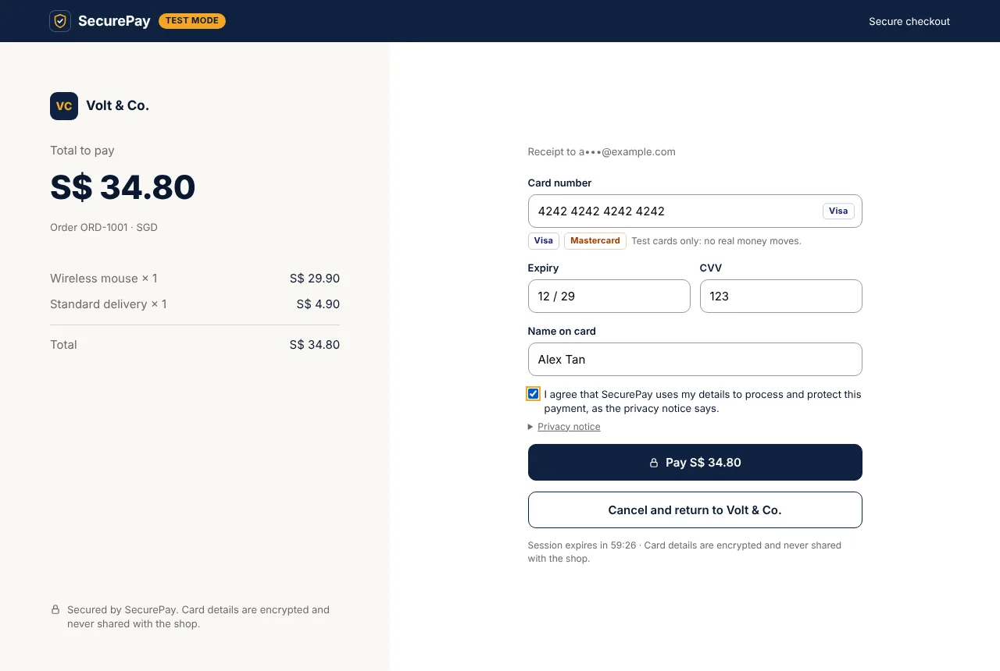
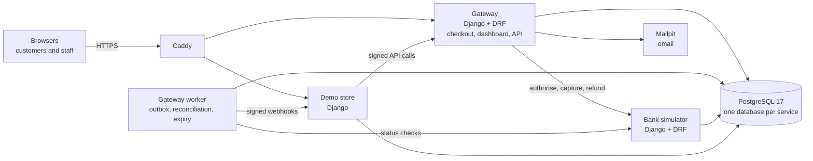

<p align="center">
  
</p>

<p align="center">
  A card payment gateway with built-in fraud screening, built end to end as a final year project.
</p>

<p align="center">
  <a href="https://csit321-secure-pay.vercel.app/">Website</a> ·
  <a href="https://gateway.35-213-144-96.sslip.io/dashboard/">Live dashboard</a> ·
  <a href="https://shop.35-213-144-96.sslip.io/">Demo store</a> ·
  <a href="contracts/API-CONTRACT.md">API reference</a> ·
  <a href="docs/DEMO-WALKTHROUGH.md">Demo walkthrough</a>
</p>

---

SecurePay takes a payment from a merchant's checkout to the bank and back. A merchant creates a payment through a signed REST API, the customer pays on a hosted checkout page, every attempt is screened for fraud before the bank sees it, and the merchant hears about the result through signed webhooks. Staff run the whole thing from a dashboard with two-step sign-in.

The bank is our own processing simulator, so the system can be tested against approvals, declines, lost replies and late replies on demand. No real cards or money are involved: everything runs on test card numbers in Singapore dollars.

This is the CSIT321 final year project of team FYP-26-S4-36 (University of Wollongong, with the Singapore Institute of Management).

<p align="center">
  
</p>

## What it does

**For merchants**
- REST API (`/v1`) to create, capture, cancel and refund payments, with API keys, signed responses and `Idempotency-Key` on every state change, so a retried request never charges twice.
- Signed webhooks (HMAC, timestamped) for every status change, retried for up to 72 hours, with a delivery log and a resend button in the dashboard.
- Self-service sign-up: register, verify the email, get approved by an administrator, then generate keys and submit a webhook address.

**For customers**
- Hosted checkout under a strict Content Security Policy. Card details go straight into an encrypted vault (AES-256-GCM) and the merchant never sees them.
- Emailed receipts (with PDF), a guest status check protected by a one-time code, and optional customer accounts with payment history.

**Fraud screening**
- Each attempt goes through deterministic rules, then a HistGradientBoosting model trained on the IEEE-CIS dataset, then a versioned policy. The outcome is allow, ask for a 6-digit email code, or block.
- Every decision is stored with its score, reasons, features and model version, and the dashboard explains why a payment was blocked (rule hits and per-feature contributions).
- Fraud analysts work a review queue across all merchants and record a finding without changing the payment.

**Reliability**
- State changes and their webhook events are written in the same database transaction (outbox pattern), and a worker delivers them.
- When the bank's reply is lost, the payment is marked Unresolved and the worker asks the simulator about the same operation ID until it has an answer. Nobody can set an outcome by hand.
- Refunds reserve their amount under a row lock, so two refunds that together exceed the payment cannot both succeed.

**Staff dashboard**
- Three roles: merchant operator, fraud analyst and administrator, each seeing only what it should.
- Password plus authenticator (TOTP) sign-in, backup codes, lockout after 5 failed attempts, 15-minute idle sessions, and an audit log of every sign-in and state change.

## Measured results

| What | Result | Source |
| --- | --- | --- |
| Fraud screening latency, as checkout calls it (target p95 200 ms) | p50 16.9 ms, p95 21.6 ms over 1,200 screenings at 20 per second | [`research/evaluation/hgb-fs02-2026-11-13.md`](research/evaluation/hgb-fs02-2026-11-13.md) |
| Fraud model ROC-AUC on the held-out report days (later in time than training) | 0.738 (average precision 0.099 at a 3.5% fraud rate) | same file |
| Non-functional requirements covered by the test report | 29 of 29 (URS Section 4.4) | [`docs/test-report/`](docs/test-report/README.md) |

The fraud experiment and its limits are written up in the evaluation file above.

## Architecture

Five services on one Linux VM, each in its own container with its own database credentials, behind Caddy for HTTPS.



| Folder | What it is |
| --- | --- |
| `gateway/` | Django 5.2 + DRF gateway. Modules in `gateway/apps/` (accounts, merchants, checkout, vault, payments, refunds, risk, events, reconciliation, audit, customers, guest, security). Each module's `__init__.py` says what it owns. The worker is `python manage.py run_worker`. |
| `simulator/` | The processing simulator: operations, ledger and fault controls |
| `merchant/` | Volt & Co., the demo store, in Django templates |
| `frontend/checkout/` | Hosted checkout (Vite + React + TypeScript) |
| `frontend/dashboard/` | Staff dashboard (Vite + React + TypeScript + MUI) |
| `frontend/website/` | The public website, deployed on Vercel |
| `frontend/brand/` | Logo, favicon and colour tokens ([`docs/BRAND.md`](docs/BRAND.md)) |
| `research/` | Notebooks, shared feature definitions, model training and evaluation |
| `contracts/` | OpenAPI files, event JSON Schemas, generated TypeScript types |
| `tests/` | Cross-service integration, load, accessibility, browser tests and the test report builder |
| `deploy/` | Docker Compose, Caddy, Postgres init, secrets templates, backups and server scripts |
| `docs/` | Scope, architecture, demo notes and the test report |

The full design is in [`docs/architecture/ARCHITECTURE-RECOMMENDATION.md`](docs/architecture/ARCHITECTURE-RECOMMENDATION.md), and the screens were planned in [Figma](https://www.figma.com/design/RK2NOWzPLfnLbAIqcswi3E).

### Tech stack

Python 3.12, Django 5.2, Django REST Framework, PostgreSQL 17, React with Vite and TypeScript, MUI, scikit-learn, pandas and NumPy, Docker Compose, Caddy, Mailpit. No Redis, Celery, Kafka or Kubernetes.

## Quick start

You need Docker, Node.js and Python 3.12.


```bash
# 1. secrets (see deploy/secrets/README.md)
cd deploy/secrets && for f in *.example; do python3 -c "import secrets; print(secrets.token_urlsafe(48))" > "${f%.example}"; done && cd ../..
# the vault (AES-256-GCM) and field keys must be 32 random bytes in URL-safe base64
for f in vault_encryption_key field_encryption_key; do
  python3 -c "from cryptography.fernet import Fernet; print(Fernet.generate_key().decode())" > "deploy/secrets/$f"
done

# 2. checkout page and staff dashboard bundles (Caddy serves them at
#    https://gateway.localhost/pay/... and https://gateway.localhost/dashboard/)
(cd frontend/checkout && npm install && npm run build)
(cd frontend/dashboard && npm install && npm run build)

# 3. whole stack
docker compose -f deploy/compose.yaml up --build
# https://gateway.localhost   https://shop.localhost   https://mail.localhost

# 4. register the demo shop as a merchant and give it its API key and signing secret
docker compose -f deploy/compose.yaml exec gateway python manage.py create_merchant "Demo Shop" \
  --webhook-url https://shop.localhost/webhooks/securepay \
  | tee /dev/stderr | awk '/API key:/{print $3 > "deploy/secrets/securepay_api_key"}
                           /Signing secret:/{print $3 > "deploy/secrets/securepay_signing_secret"}'
docker compose -f deploy/compose.yaml restart merchant

# 5. staff accounts for the dashboard (password prompt, 12+ characters; the authenticator
#    app is set up at the first sign-in from the QR code on the two-step page)
docker compose -f deploy/compose.yaml exec gateway python manage.py create_staff ops@demoshop.sg \
  --role merchant_operator --merchant mer_... --name "Aisha Rahman"   # the ID create_merchant printed
docker compose -f deploy/compose.yaml exec gateway python manage.py create_staff analyst@securepay.sg \
  --role fraud_analyst --name "Daniel Lim"
docker compose -f deploy/compose.yaml exec gateway python manage.py create_staff admin@securepay.sg \
  --role administrator --name "Mei Tan"
```

Steps 4 and 5 in one go, for the Volt & Co. demo: `bash deploy/demo.sh seed` (merchant, the three staff logins with temporary passwords, the shop's key and secret). Before each demo run `bash deploy/demo.sh reset` (restock, empty inbox, fresh demo cards and emails, health check; `deploy/RUNBOOK.md` section 11a).

Then shop at https://shop.localhost and pay with test card 4242 4242 4242 4242 (approves). 4000 0000 0000 0002 declines and 4000 0000 0000 0119 loses the bank's answer. The [demo walkthrough](docs/DEMO-WALKTHROUGH.md) goes through every story: fraud checks, lost answers, refunds, guest status and fault injection.

For day-to-day work on one service, see that service's README (venv + `runserver`).

## Testing

```bash
cd gateway && python3.12 -m venv .venv && . .venv/bin/activate && pip install -e ".[dev]"
DJANGO_DEBUG=1 python manage.py check && ruff check . && pytest
cd ../frontend/dashboard && npm install && npx tsc --noEmit && npm test
```

- Cross-service tests for demo stories S1-S6, receipts, guest status and fault controls: [`tests/integration/README.md`](tests/integration/README.md).
- Acceptance tests numbered after the URS are in `gateway/acceptance/`; the checkout load test is `tests/load/checkout_load.py`.
- The non-functional test report (all 29 requirements in URS Section 4.4) is built from the test results and manual checks: [`docs/test-report/README.md`](docs/test-report/README.md). Security and accessibility results are in the same folder.
- CI (`.github/workflows/ci.yml`) runs lint, type checks, tests on real PostgreSQL, dependency audits and gitleaks, only for the parts a change touches. `ci-ok` is the check to require.

## Deployment

The public demo runs on one VM with sslip.io names and Let's Encrypt certificates. Setup, updates, backups and recovery are in [`deploy/RUNBOOK.md`](deploy/RUNBOOK.md); the checklist for a live demo is [`docs/DEMO-DAY.md`](docs/DEMO-DAY.md).

## Engineering rules

- Services talk only over authenticated HTTPS APIs; each has its own database and credentials.
- Only `contracts/` and `research/features/` are shared. The payment state machine is **not** shared between gateway and simulator.
- Card data lives only in `gateway/apps/vault`, on its own database role. Logs, audit events, outbox payloads, idempotency fingerprints and screening features must never contain it, and tests enforce this.
- Business numbers (SGD only, S$0.50 to S$10,000, 24 h idempotency, 7-day authorisation expiry, 10-minute verification code, 500 ms screening timeout, and so on) live in one place: `GATEWAY_RULES` in `gateway/config/settings.py`.
- Python 3.12 everywhere; scikit-learn is pinned to the same version in `gateway/` and `research/`.

See [`CONTRIBUTING.md`](CONTRIBUTING.md) for branches, pull requests and review rules, and [`docs/MVP-SCOPE.md`](docs/MVP-SCOPE.md) for scope and the six demo stories.

## Team

| Name | Role |
| --- | --- |
| Yeoh Liu Ying | Project leader and documentation lead |
| Muhammad Adeeb | System designer and simulator developer |
| Chirawatana Janyaporn | Lead back-end developer |
| Chew Jun Han | Front-end developer |
| Kamolmongkolsuk Noppawut | Fraud experiment, security and test lead |

SecurePay is a student project for learning and demonstration. It is not a licensed payment service and must not be used with real card data.
