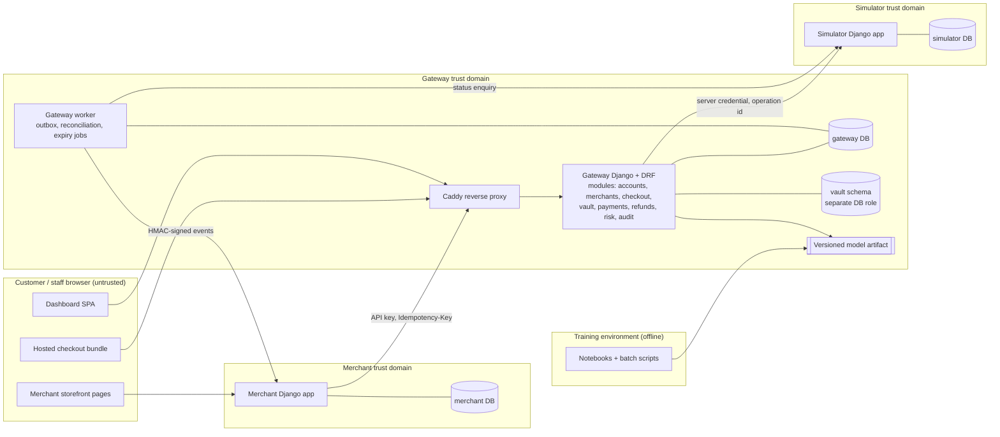
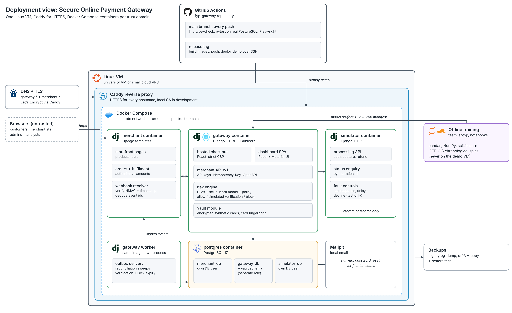
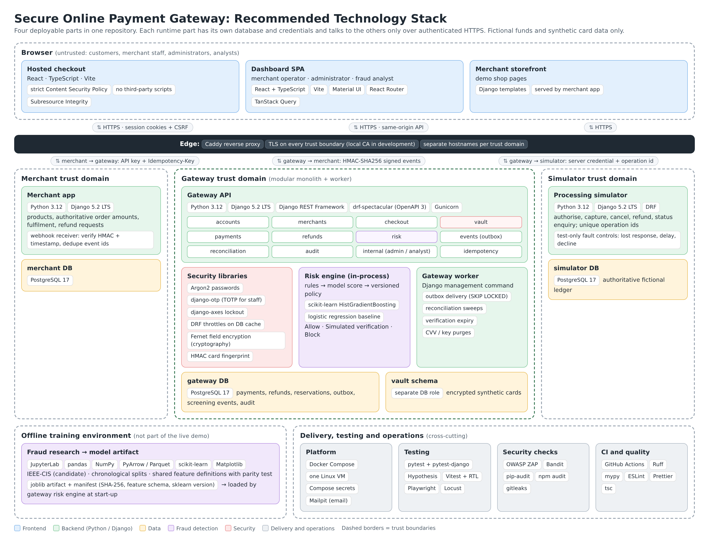
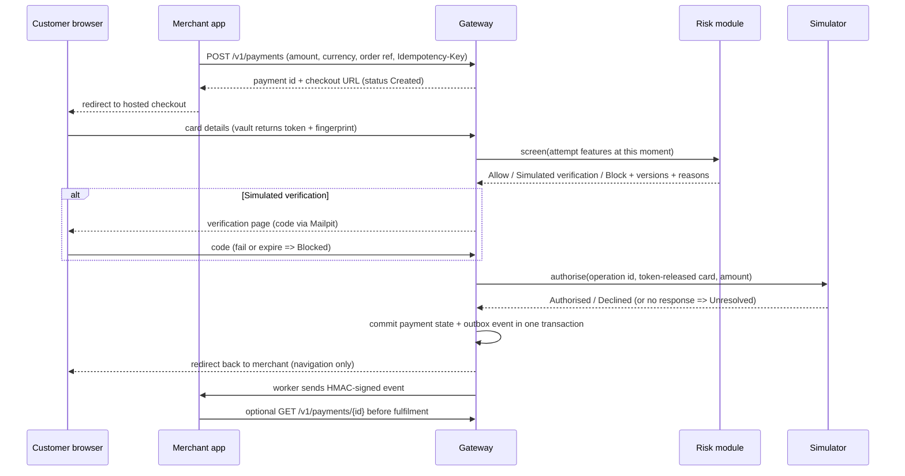

# Secure Online Payment Gateway: recommended full architecture

Prepared 20 October 2026 for Fifa. Status: recommendation for team review. Nothing here has been implemented or tested, and no report file was edited.

This document builds on `05-architecture/TECH-STACK-PROPOSAL.md` (the detailed Codex proposal), Chapters 1 to 3 of the report and the 11 October handover decisions. **The Codex proposal is sound and I recommend keeping its overall shape.** This document makes the final choices explicit, fills six gaps that matter for a payment gateway specifically, and corrects three suggestions I made earlier in chat that conflicted with your confirmed scope.

## 1. Corrections to my earlier chat reply

Before reading your project files I suggested three things that I now withdraw.

**Stripe test mode as the processor.** Your scope already places a separate processing simulator behind the gateway, and the recovery experiments depend on controlling its faults (lost responses, delays, declines). Stripe test mode would remove that control and blur the trust boundary in Figure 3.2.1. Keep the simulator.

**Celery with Redis.** The transactional outbox in Section 2.4.3 needs a database table anyway, so a PostgreSQL-backed worker gives durable notifications without a second stateful service. Celery would add a broker whose messages are not committed together with the payment update, which is exactly the problem the outbox solves. Defer Celery unless measured load demands it.

**XGBoost.** Your experiment compares *feature sets* within one model family, not algorithms. scikit-learn's `HistGradientBoostingClassifier` is a histogram-based gradient-boosting model of the same kind as LightGBM, handles missing values natively and keeps the whole pipeline in one library. It is the better choice here; XGBoost or LightGBM can appear only as an optional sensitivity check.

## 2. Architecture at a glance

The system is **four deployable parts in one repository**: the gateway (a modular Django application plus a background worker), the processing simulator, the demonstration merchant, and an offline training environment. Each runtime part has its own database and credentials and talks to the others only over authenticated HTTPS APIs.



The deployment view below shows how these parts run on one Linux VM behind Caddy, with CI deploying from GitHub Actions.



*Deployment view: one VM, Caddy, Docker Compose containers per trust domain, offline training and backups outside the VM.*

## 3. Final technology choices



*Technology stack by trust domain. Source: `tech-stack-diagram.html`, rendered to PNG.*

| Layer | Choice | Why this is the best fit |
|---|---|---|
| Language (server) | Python 3.12 | One language for gateway, simulator, merchant and fraud research; the model loads directly in the gateway process |
| Gateway framework | Django 5.2 LTS + Django REST Framework | Mature accounts, sessions, CSRF, ORM transactions and migrations; LTS support runs to April 2028, beyond your submission |
| API contract | OpenAPI 3 generated by drf-spectacular; TypeScript types generated from it | One source of truth for the merchant integration guide and the frontends |
| Database | PostgreSQL 17 (three logical databases on one server for the demo) | Row locking for refund capacity, `SKIP LOCKED` for worker claims, unique constraints for idempotency, partial indexes for history features |
| Background work | Gateway worker: a Django management command polling outbox and job tables | Commits notifications atomically with payment changes; also runs reconciliation, verification expiry and data purges |
| Rate limiting | DRF throttles on a PostgreSQL `DatabaseCache`; django-axes for login lockout | Shared across Gunicorn workers without adding Redis; counts are approximate, which is acceptable for abuse limits |
| Staff authentication | Password (Argon2) plus TOTP second factor via django-otp for merchant operators, administrators and analysts | Raises the bar on stolen passwords; the report must still not call OTP phishing-resistant. Passkeys (WebAuthn) are a stretch goal |
| Customer authentication | Django sessions, Argon2, email-based reset; guests receive a scoped, expiring status token | Matches the confirmed account and guest scope |
| Card data handling | Gateway `vault` module with field-level encryption (Fernet from the `cryptography` package) and a keyed card fingerprint | See Section 5; the gap most likely to be questioned by an examiner |
| Hosted checkout | A small separate Vite/React bundle served by the gateway under a strict Content Security Policy, no third-party scripts | Mirrors the payment-page script controls in PCI DSS v4 (requirements 6.4.3 and 11.6.1) without claiming compliance |
| Dashboards | React + TypeScript + Vite + Material UI, React Router and TanStack Query; one SPA with role-based routes for merchant operator, administrator and analyst | Reuses tables and forms; the backend remains the authority on permissions |
| Merchant storefront | Plain Django templates in the merchant app | The storefront is a test harness, not the product; templates save a second React build |
| Fraud research | pandas, NumPy, PyArrow/Parquet, JupyterLab, scikit-learn (`LogisticRegression`, `HistGradientBoostingClassifier`), Matplotlib | Single library for both candidates; chronological evaluation tools are in scikit-learn |
| Model serving | In-process in the gateway; artifact saved with joblib alongside a manifest (SHA-256, feature schema version, scikit-learn version, threshold policy) | Fast, simple; the hash check ensures only the team's own trusted artifact is loaded |
| Reverse proxy and TLS | Caddy, with a local CA in development | HTTPS on every trust boundary, including service-to-service calls inside Docker |
| Packaging and hosting | Docker Compose on one Linux VM; Compose secrets mounted as files | Reproducible demo; no Kubernetes |
| Local email | Mailpit | Exercises registration, recovery and simulated-verification codes without a real email provider |
| Testing | pytest, pytest-django, Hypothesis, Vitest, React Testing Library, Playwright, Locust | Unit, property, concurrency, end-to-end and load evidence |
| Security tooling | OWASP ZAP, Bandit, pip-audit, npm audit, gitleaks | Supports, but does not replace, the explicit access-control tests |
| CI and quality | GitHub Actions; Ruff, mypy (gateway core modules), ESLint, Prettier, tsc | Every push runs migrations, tests against real PostgreSQL and dependency checks |

**What I would deliberately leave out:** Redis, Celery, Kafka, Kubernetes, microservices inside the gateway, a feature store product, a model-serving server, deep learning and cloud-specific services. None of them is needed to meet a confirmed requirement, and each adds failure modes your evaluation would then have to cover.

## 4. Gateway internal modules

The gateway is a **modular monolith**: one deployable application whose code is split into Django apps with one-way dependencies. This gives clear ownership for the team without network calls between modules.

| Module | Owns | Key rule |
|---|---|---|
| `accounts` | Customers, staff users, roles, MFA devices, guest status tokens | Authentication never implies access to a specific payment |
| `merchants` | Merchants, memberships, API keys (stored as digests), webhook endpoints and signing secrets | Merchant identity always comes from the validated credential, never from the request body |
| `checkout` | Checkout sessions, hosted page flow, simulated verification | Browser input cannot change merchant, amount or currency |
| `vault` | Encrypted card data, tokens, card fingerprints | The only module allowed to decrypt; separate database role |
| `payments` | Payment, processing operations, state machine, idempotency records | One financial effect per logical operation |
| `refunds` | Refunds, reservations | `completed + reserved <= refundable base` under a row lock on the payment |
| `risk` | Screening events, feature builder, rules, model adapter, policy, decisions | Uses only information available before submission |
| `events` | Outbox, delivery attempts, merchant notification state | Delivery state never changes payment state |
| `reconciliation` | Unresolved sweeps, discrepancy records, evidence-backed corrections | Corrections require simulator evidence and an audit entry |
| `audit` | Append-only audit events with correlation IDs | No secrets, tokens or card data in any record |
| `internal` | Admin and analyst endpoints, case assignment, findings | Findings never rewrite processing outcomes |

## 5. Card data: the vault boundary

The current documents say "synthetic credentials" but do not say where a card number goes once the customer types it. A real gateway keeps this path as small as possible, and an examiner is likely to ask about it.

**Recommended flow.** The hosted checkout posts the synthetic card number, expiry and CVV once to `POST /checkout/{session}/card`. The vault immediately encrypts the card number and CVV, stores them under a random token, and returns only the token, brand, last four digits and a **card fingerprint** computed as HMAC-SHA256 of the card number with a server secret. The rest of the gateway handles only the token and fingerprint. At submission the payments module asks the vault to release the card details for one simulator call; the vault then **deletes the CVV immediately**, whatever the outcome, and deletes the encrypted card number after the payment reaches a final state or after a short retention window.

**Why it matters for your research.** The fingerprint is a stable key for prior-activity features (attempts per card in the last hour, distinct merchants per card in 24 hours) without storing a readable card number. This is the same idea as the card fingerprint that Stripe exposes on its card objects.

**Data that must never contain card data:** idempotency request fingerprints, outbox payloads, logs, audit events, screening features and analytics exports. Make these exclusions a test, not a convention.

## 6. Core payment flow



The **merchant API** follows the resource style that Stripe and Adyen document: `POST /v1/payments`, `GET /v1/payments/{id}`, `POST /v1/payments/{id}/capture`, `POST /v1/payments/{id}/cancel`, `POST /v1/payments/{id}/refunds` and `GET /v1/refunds/{id}`. Every state-changing call requires an `Idempotency-Key`; a reused key with a different body returns 409. Events are named `payment.authorised`, `payment.declined`, `payment.blocked`, `payment.unresolved`, `payment.captured`, `payment.cancelled`, `refund.completed` and `refund.failed`, each with an event ID, a sequence number per payment and a signed timestamp.

**Capture.** The simplest consistent choice is that the merchant captures explicitly through the API after deciding to fulfil, which exercises both the Authorised and Captured states in Figure 2.2.2.1. An automatic-capture option can be added later. This is still an open decision for the team.

## 7. Fraud screening architecture

Screening is a **three-stage pipeline inside the `risk` module**, run synchronously before the simulator call.

**Stage 1, feature building.** The module records a screening event for the attempt (unique on the attempt ID, so a retried request cannot be counted twice) and computes current-transaction features plus prior-activity features with indexed SQL counts over earlier events: per card fingerprint, per customer or guest email hash, per IP and per device cookie, in fixed windows. Only events that happened strictly before the current one are counted.

**Stage 2, rules then model.** Deterministic rules run first (amount over a merchant limit, a blocklisted fingerprint, a burst of attempts) because they are inspectable and drive the scripted scenarios. The model then produces a score using a fixed feature schema.

**Stage 3, policy.** A versioned policy maps rule results and score to Allow, Simulated verification or Block using thresholds chosen on validation data. Each decision stores the score, the model, policy and feature-schema versions, the reasons and the feature values used, so an analyst can see why it happened.

**Keeping offline and online features the same.** Write each feature definition once in a shared Python module with two adapters: a pandas implementation for the experiment and a SQL implementation for runtime. Add a **parity test** that replays a few thousand mapped historical rows through both and requires identical values. This directly supports the report's warning that offline and deployable feature sets may differ.

**When scoring fails or is slow.** Use a timeout budget (to be set from measurements). If the model is unavailable, stop before submission and show a recoverable technical error, as the Codex proposal recommends; never label the customer fraudulent. During early development a fixed policy stub stands in for the model.

**Model artifact handling.** The training environment writes the model, its manifest and evaluation results to a versioned folder. The gateway loads it at start-up only if the SHA-256 in the manifest matches and the scikit-learn version is identical, because pickle-based formats can run code on load and do not load across versions.

## 8. Correctness mechanisms

These follow Sections 2.4 and 3.5 of the report and the Codex proposal, and are summarised here so the architecture is complete.

**Idempotency** is a table keyed by merchant and key, storing a request fingerprint, the resulting operation and the stored response; an in-flight duplicate waits or receives 409. **Operation identity** is generated by the gateway and sent to the simulator, which enforces uniqueness on it, so a status enquiry or retry never creates a second financial effect. **Refund capacity** is checked under `SELECT ... FOR UPDATE` on the payment row in the same transaction that creates the reservation. **Unresolved outcomes** are picked up by the reconciliation job, which queries the simulator with the original operation ID and records evidence before any change. **The outbox** is written in the same transaction as each state change; the worker claims rows with `FOR UPDATE SKIP LOCKED`, sends outside the transaction, retries with bounded backoff and marks exhausted deliveries for staff attention. **Event ordering** uses a per-payment sequence number so the merchant can ignore older events.

## 9. Security controls mapped to the report's threats

| Threat (report section) | Control in this architecture |
|---|---|
| Cross-merchant or cross-customer access (2.3.1) | Queryset scoping by merchant membership or customer ownership in every view; object-level checks; automated negative tests for each endpoint |
| Stolen staff password (2.3.1) | TOTP second factor, django-axes lockout, session rotation on login |
| Altered checkout values (2.3.2) | Amount, currency and merchant fixed server-side at payment creation; checkout session bound to the payment |
| Forged or replayed notifications (2.3.2) | HMAC-SHA256 over timestamp and exact body, five-minute tolerance, event-ID deduplication at the merchant |
| Card data exposure (2.3.2) | Vault encryption, CVV deleted after one use, no card data outside the vault, redaction tests on logs |
| Script injection on the payment page | Separate checkout bundle, strict CSP with nonces, no third-party scripts, Subresource Integrity on built assets |
| Automated abuse (2.3.3) | DRF throttles per API key, per IP and per checkout session; login lockout |
| Server-side request forgery (2.3.3) | Webhook URLs restricted to pre-registered HTTPS hosts; outbound requests resolved and checked against private ranges except an explicit demo allowlist |
| Credential leakage | API keys stored as digests, shown once; secrets as Compose files outside Git; gitleaks in CI |
| Audit gaps (2.3.4) | Append-only audit table with actor, merchant, operation, action, outcome and correlation ID; no update permission for the application role |

## 10. Repository layout

```
fyp-gateway/
  gateway/          Django project: accounts, merchants, checkout, vault, payments,
                    refunds, risk, events, reconciliation, audit, internal
  simulator/        Django project: operations, ledger entries, fault controls
  merchant/         Django project with templates: products, orders, webhook receiver
  frontend/
    checkout/       Minimal hosted checkout bundle (strict CSP)
    dashboard/      Merchant, administrator and analyst SPA
  research/         Notebooks, feature definitions (shared with gateway/risk), training scripts
  contracts/        OpenAPI files, event schemas, generated TypeScript types
  tests/integration End-to-end, recovery, concurrency and security scenarios across services
  deploy/           Compose files, Caddyfile, secrets templates, backup scripts
```

Share contracts and feature definitions, but **do not share the payment state-machine code between the gateway and the simulator**, so independent tests can catch a defect in either.

## 11. Implementation decisions (confirmed by Fifa, 20 October 2026)

These were open questions in the first draft. Fifa accepted all seven recommendations on 20 October 2026; they feed the Chapter 4 business rules and non-functional requirements.

| Decision | Confirmed choice | Reason |
|---|---|---|
| Capture | The merchant captures explicitly through `POST /v1/payments/{id}/capture` when it decides to fulfil. The worker cancels any authorisation still uncaptured after 7 days. | Exercises Authorised, Captured and Cancelled as distinct states in Figure 2.2.2.1 |
| Card data retention | The encrypted card number and CVV are deleted as soon as the payment is submitted to the simulator, or when the attempt ends without submission. The gateway keeps only the token, brand, last four digits, expiry and card fingerprint. | Recovery and refunds use the operation ID, so card details are never needed after submission |
| Idempotency key retention | 24 hours from first use | Matches Stripe's documented window; long enough for merchant retries |
| Simulated verification | The code is valid for 10 minutes. One wrong code or expiry ends the attempt as Blocked; the customer starts a new attempt. | Follows the 11 October rule of no in-attempt retry counter |
| Guest access | The checkout session token lasts 1 hour. After checkout the guest receives an emailed, read-only status link for that one payment, valid for 30 days. | Order reference alone never grants access; access is narrow and expires |
| Screening time and unavailability | Target p95 of 200 ms or less including feature lookup; hard timeout at 500 ms. If scoring is unavailable or times out, the attempt ends Blocked with reason `screening_unavailable`, never presented as fraud, and the customer is told to try again. | Stops before any financial effect without adding a new payment state |
| Currency and amounts | SGD only, stored as integer cents. Minimum S$0.50, maximum S$10,000 per payment. | One currency keeps amount rules and refund arithmetic simple |
| Experiment targets | Primary operating point: false-positive rate of 1% or less, threshold chosen on validation data, reporting recall and precision there. Also report 0.5% and 2%. Latency: screening meets the 200 ms p95 at a stated load of 20 requests per second on the demo VM. | Gives the historical-feature comparison a fixed constraint before the test set is opened |

**Follow-up for the code skeleton.** `06-code` (owned by the code folder setup thread) predates these choices. It will need settings for these values (capture expiry, idempotency TTL, verification TTL, guest token lifetimes, screening timeout, currency and amount limits), worker jobs for authorisation expiry and card-data purges, and a `screening_unavailable` block reason.

## Sources consulted

- Project files: `05-architecture/TECH-STACK-PROPOSAL.md`, `01-report/current/fyp-report-ch1-3.md` (Sections 2.2 to 2.5, 2.7, 3.2 to 3.7), `04-handover/PROJECT-CONTEXT.md`, `04-handover/DECISIONS-AND-NEXT-STEPS.md`.
- [scikit-learn model persistence](https://scikit-learn.org/stable/model_persistence.html): pickle and joblib can execute code on load and do not load across scikit-learn versions.
- [Stripe Radar lists](https://stripe.com/docs/radar/lists): card fingerprint as a stable identifier for a card number.
- [Stripe guide to fraud management with Radar](https://stripe.com/guides/improve-fraud-management-with-radar-and-stripe-data): machine-learning scoring combined with allow, review and block rules.
- [PCI DSS 4.0.1 requirements 6.4.3 and 11.6.1 (Report URI)](https://blog.report-uri.com/pci-dss-4-0-1-and-requirements-6-4-3-and-11-6-1-what-changed-for-payment-page-scripts/) and [Barr Advisory overview](https://www.barradvisory.com/resource/pci-payment-page-security/): payment-page script authorisation, integrity and change detection. Secondary sources; cite the PCI SSC standard itself in the report.
- [Django 6.0 release notes](https://docs.djangoproject.com/en/6.0/releases/6.0/) and [Loopwerk review of Django Tasks](https://www.loopwerk.io/articles/2026/django-tasks-review/): the built-in tasks framework has no production worker, so it does not replace the outbox worker.
- [DRF throttling guide](https://www.django-rest-framework.org/api-guide/throttling/): throttles rely on the Django cache, which must be shared across processes.
